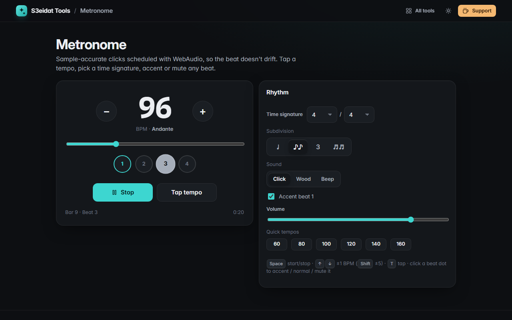

# Metronome

> An accurate metronome with tap tempo, accents and subdivisions. Free, private, and it runs entirely in your browser.

### ▶ [Open Metronome](https://s3eidat.github.io/metronome/)



## Features

- **Sample-accurate timing**: clicks are scheduled ahead on the WebAudio clock, so they don't drift or wobble when the page is busy
- **20–300 BPM** with a big editable number, slider, ± buttons and quick tempos; shows the tempo marking (Andante, Allegro…)
- **Tap tempo** (averages your last taps)
- **Time signatures** 1–12 beats over 2, 4, 8 or 16
- **Accent, normal or mute** any beat (click its dot); accent beat 1 by default
- **Subdivisions**: eighths, triplets, sixteenths
- Three sounds (click, wood, beep) and volume
- **Visual beat** with bar and beat counter and elapsed time
- Keyboard: <kbd>Space</kbd> start/stop, <kbd>↑</kbd>/<kbd>↓</kbd> ±1 BPM (<kbd>Shift</kbd> ±5), <kbd>T</kbd> tap
- Remembers your settings

## Privacy

There is no server, no account, no analytics. The page ships with a strict Content-Security-Policy
(`connect-src 'self'`), so the browser itself blocks any attempt to send data anywhere.

## Run it yourself

It's plain HTML, CSS and JavaScript with no build step:

```bash
git clone https://github.com/s3eidat/metronome
cd metronome
python -m http.server 8000
```

Then open http://localhost:8000.

## Support

If this saved you time, **[buy me a coffee ☕](https://s3eidat.github.io/coffee/)**. It keeps every tool free.

---

Part of **[S3eidat Tools](https://s3eidat.github.io/)**: 100+ free, private tools that run in your browser. MIT licensed.
